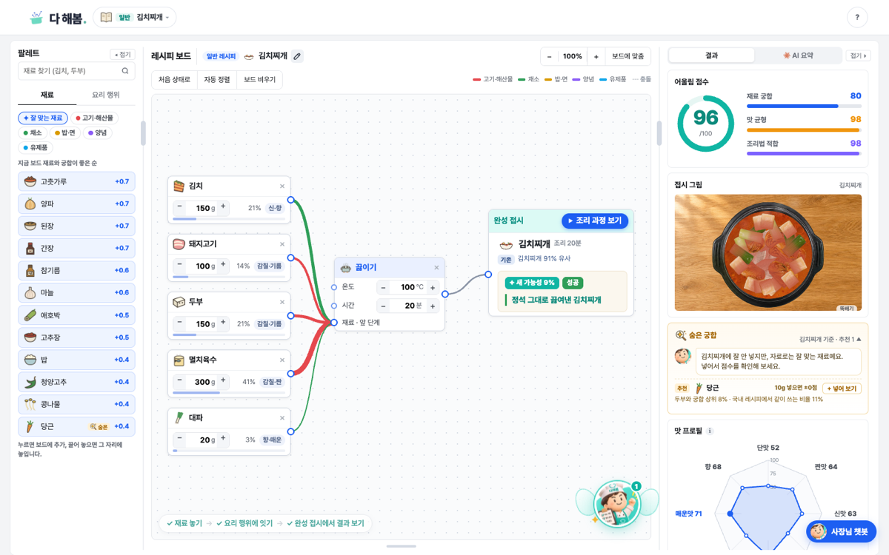
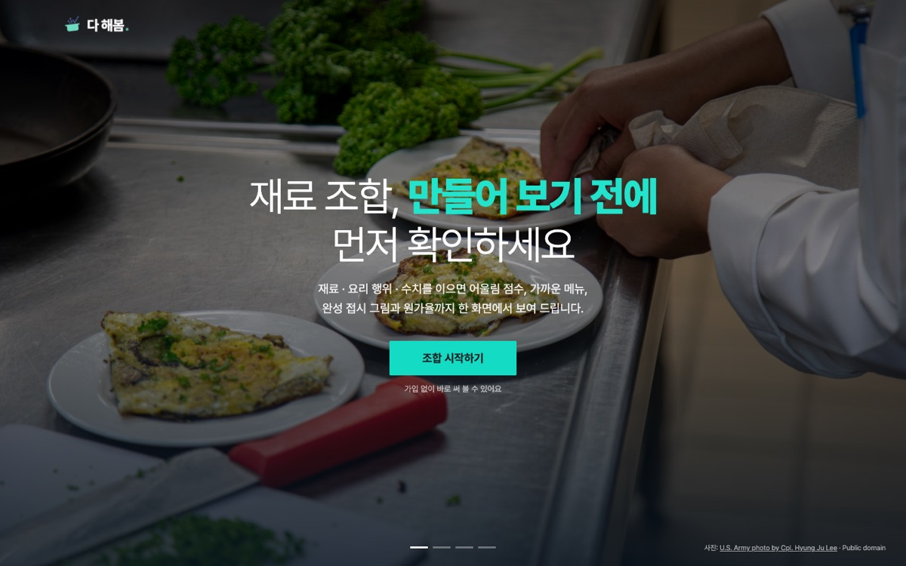

# 다 해봄 · 메뉴 궁합 실험실

신메뉴 개발 전에 재료와 조리법을 보드에 이어 어울림 점수, 원가, 예상 메뉴를 확인하는 식당 사장님용 웹 앱



| 기간 | 대회 | 결과 | 배포 |
|---|---|---|---|
| 2026.11.6 ~ 15 (본선 무박 2일) | AIX 해커톤 | 대상 | https://dahaebom.vercel.app |

## 문제의식

- 프랜차이즈는 본사가 신메뉴 개발, 개인 매장은 사장님이 직접 개발
- 자영업자 커뮤니티 '아프니까 사장이다' 글 분석 결과: 매출 감소를 신메뉴로 버티려는 글, 출시 뒤 손님 반응을 묻는 글, 검색 결과를 믿지 못해 다른 사장님 의견을 구하는 글 다수
- 재료를 사서 만들어 보기 전에는 조합의 적절성 확인 불가
- 메뉴 개발이 비용이 큰 시행착오로 반복

## 해결 방법

- 재료 구매 전에 화면에서 조합을 먼저 시험
- 조리 점수: 고른 재료가 실제 레시피에서 함께 쓰인 정도
- 향미 점수: 재료끼리 공유하는 향 성분의 정도
- 두 점수의 비중은 사장님이 직접 조절
- 점수와 함께 원가, 영양, 근거 레시피 제시

## 주요 기능



- 레시피 보드: 재료와 조리 행위를 이어 레시피 구성, 재료 쌍의 점수 기여도를 선 굵기로 표시
- 점수와 근거: 조합 점수, 조리·향미 점수, 함께 쓰인 레시피와 공유 향 성분
- 원가와 영양: 넣은 양 기준 원가, 원가율, 열량·당류·나트륨
- 재료 추천: 넣으면 점수가 오르는 재료
- AI 요약: 결과 요약, 메뉴 초안과 이름 제안
- 상권 자료와 보고서: 서울시 실시간 상권 자료 조회, PDF 보고서 출력

## 만들며 부딪힌 문제

- 재료 양을 크게 늘려도 점수 불변
  - 원인: 재료 종류만 보고 양을 반영하지 않던 계산식
  - 해결: 값 하나만 바꿔 점수 방향을 확인하는 시험표 작성, 계산식 수정
- 육수를 늘릴수록 짠맛이 진해지는 역방향 결과
  - 원인: 양을 더하기만 하고 묽어짐을 반영하지 않은 맛 계산
  - 해결: 농도 기준으로 수정, 탄 맛과 익힘 부족 경고 추가
- 결과 칸에서 점수와 원가가 스크롤 밖에 위치
  - 원인: 숨은 궁합 카드의 맨 위 배치
  - 해결: 화면 캡처 점검 뒤 점수와 원가율을 맨 위로 이동, 안내 말풍선 기본 접기

## 회고

- 고객 목소리의 출처: 글로컬 창업 공모전 멘토링에서 받은 조언(구체적인 고객 목소리는 자영업자 카페 '아프니까 사장이다'에서 찾을 것)에서 착안
- 프로틴더 경험의 재사용: 가격 정보를 연동하려고 네이버 클라우드의 API HUB를 써 본 경험 덕분에 카페 글도 같은 방식으로 빠르게 불러올 수 있다는 점을 파악
- 모델을 나눠 쓰기: Claude Max와 GPT Pro를 함께 쓰며 각자의 장점을 활용, 대량 작업은 비용이 낮은 GPT에 CLI로 지시해 원문을 분류하고 정리한 뒤 고객 목소리를 도출
- 협업에 대한 생각의 변화: 예전에는 일을 똑같이 나눌 수 없으니 더 하는 사람을 힘써 도와야 한다고 막연히 생각. 이번에는 맡은 양이 많았지만 그것을 내세우지 않고 모두가 똑같이 하고 있다는 감각으로 의견을 존중하고 반영했더니 짧은 기간에도 팀워크와 결과물이 모두 좋았음
- 값 하나만 바꿔 보는 시험: 재료 양이나 육수처럼 값 하나만 바꿔 점수가 맞는 방향으로 움직이는지 확인해 계산 오류를 시연 전에 발견
- 검증하지 못한 점수: 조리 점수와 향미 점수를 실제 맛 평가나 시장 자료로 확인하지 못했고 재료 단가는 가정값
- 사장님 사용 시험 없음: 고객 목소리에서 출발했지만 만든 것을 사장님이 직접 써 보게 하는 단계는 아직 없음

## 기술

- 정적 페이지(HTML, JavaScript), Vercel 서버 함수, Claude API
- AI 도구: 기획과 구현 전 과정을 AI 코딩 도구(Claude Code, Codex)로 진행, 화면 속 요약·메뉴 초안·챗봇은 서버 함수에서 Claude API 호출

| 부분 | 파일 |
|---|---|
| 시작 화면 | `index.html` |
| 실험실 화면(주소 `/dahaebom`) | `pairing.html` |
| 점수 계산기 | `lab/engine.js` |
| 레시피 보드, 접시 그림, 결과 칸 | `lab/graph.js`, `lab/plate.js`, `lab/app.js` |
| PDF 보고서 | `lab/report.js` |
| 설문, 상단 바, 사용법 안내, AI 화면 | `lab/survey.js`, `lab/topbar.js`, `lab/tour.js`, `lab/ai.js` |
| 재료와 학습 궁합 값 | `lab/data.js`, `lab/learned.js` |
| AI 요약, 챗봇, 메뉴 초안, 새 이름 | `api/ai.js` |
| 서울시 실시간 상권 조회 | `api/sangwon.js` |
| AI 지시문 | `api/_prompts.js` |

## 자료 출처 · 실행

- 재료 궁합 학습: RecipeNLG 영어 레시피, 식품의약품안전처 조리식품 레시피 DB, 만개의레시피 공개 레시피
- 상권: 서울 열린데이터광장 서울시 실시간 상권현황(OA-22385)
- 재료 단가와 메뉴 비교 판매가: 시연용 가정값

```bash
npm install
npx vercel dev
```

`.env.example`의 환경변수 세 가지

- `ANTHROPIC_API_KEY`: Claude API 키
- `SEOUL_API_KEY`: 서울 열린데이터광장 인증키
- `ALLOWED_ORIGINS`: 앱이 올라간 주소

참고

- `api/_prompts.js`는 원래 지시문 대신 임시 문장. 그대로도 작동하지만 AI 답변의 말투와 형식은 미정
- 키가 없으면 점수 계산, 보드, 접시 그림, PDF는 작동, AI 기능과 상권 자료만 꺼짐
- 정적 화면만 볼 때는 정적 서버로 폴더를 열고 `pairing.html` 열기
